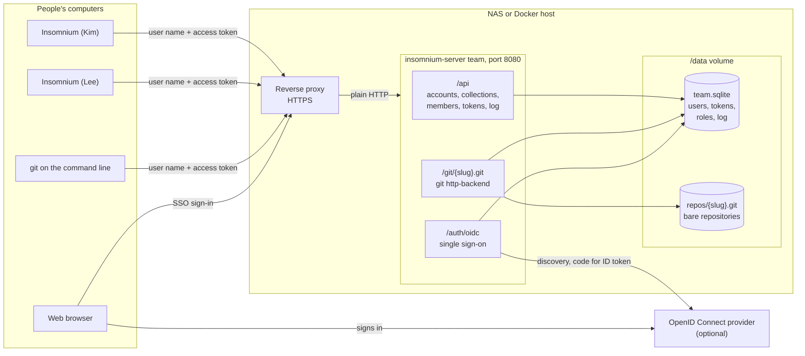
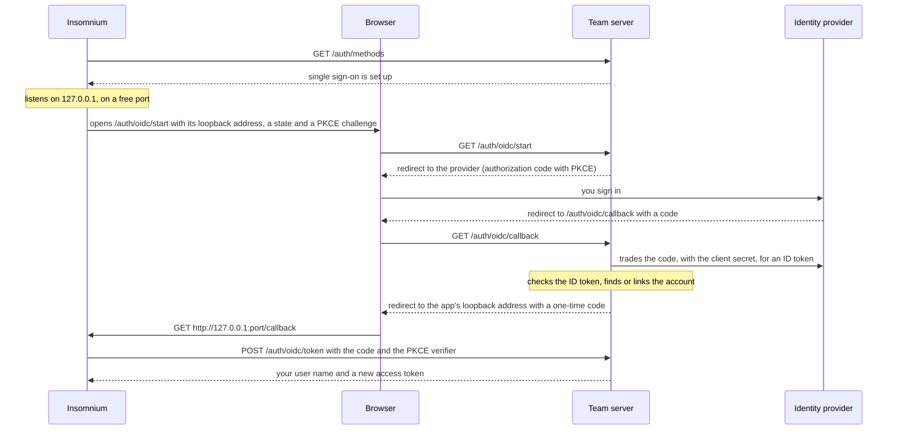

# Team server

A team server shares your collections from a machine on your own network: a NAS, a home server, or any computer with Docker. It's insomnium-server's `team` mode. Each collection is a Git repository on the server, and everyone works on it with [Git Sync](git-sync.md). The server adds accounts, a role for each person on each collection, a log of who pushed what, and, if you want it, single sign-on through your identity provider. Nothing goes through a cloud service.

The reference for every option and API call is [Share collections with a team](../packages/insomnium-server/README.md#share-collections-with-a-team). This page walks through setting one up.

## How it works

Take a small office: a NAS or a Docker host runs the server, a reverse proxy in front of it adds HTTPS, and a few people's Insomnium apps sync collections with it. An identity provider is optional.



- **`/api`** is a JSON API. The app uses it to sign in, list the collections you can use, and create new ones. Admins and owners use it for accounts and members.
- **`/git/<slug>.git`** serves each collection's repository with Git's own `git http-backend`. Every call is signed in. Fetching needs the viewer role, pushing the editor role.
- **`/auth/oidc`** handles single sign-on, when it's set up.
- **`/data`** holds everything: the accounts, tokens, roles and log in one SQLite file, `team.sqlite`, and the repositories under `repos/`.

The server speaks plain HTTP on port 8080. Each call carries a user name with a password or an access token, so put HTTPS in front of it.

## Run the server

The image is `ghcr.io/yokomohoyo/insomnium-server`, tagged with each release's version (such as `0.7.0`) and `latest`. It runs on linux/amd64 only, so on a NAS that's an Intel or AMD model.

### With Docker

```sh
docker run -d --name insomnium-team --restart unless-stopped \
  -p 8080:8080 \
  -v /srv/insomnium-team:/data \
  -e INSOMNIUM_TEAM_ADMIN=kim \
  -e INSOMNIUM_TEAM_URL=https://insomnium.example.com \
  ghcr.io/yokomohoyo/insomnium-server:0.7.0 team
docker logs insomnium-team
```

The first start makes the admin `INSOMNIUM_TEAM_ADMIN` names (`admin` if you leave it out), and the log shows its password once. To choose the password yourself, set `INSOMNIUM_TEAM_ADMIN_PASSWORD` instead. Either way, only the first start makes an admin: once there's an account, those two are ignored.

The container runs as uid 1000. A folder you mount on `/data` has to be writable by it:

```sh
sudo mkdir -p /srv/insomnium-team && sudo chown 1000 /srv/insomnium-team
```

On a Synology, see [the server's README](../packages/insomnium-server/README.md#share-collections-with-a-team) for the folder's permissions and the reverse proxy rule.

`INSOMNIUM_TEAM_URL` is the address people reach the server at. It goes into the clone URLs the server hands out, and into the SSO redirect URL. Without it, the server takes the address from each request, or from the reverse proxy's `X-Forwarded-Proto` and `X-Forwarded-Host` headers.

Other settings: `INSOMNIUM_PORT` (default 8080), `INSOMNIUM_HOST` (default 0.0.0.0), and `INSOMNIUM_TEAM_DATA` (default `/data`). Each has a flag too: `--port`, `--host`, `--data` and `--public-url`.

### With Docker Compose and HTTPS

This runs the server behind [Caddy](https://caddyserver.com/), which gets and renews an HTTPS certificate for you. The data goes in a named volume, which Docker creates with the right owner.

`compose.yaml`:

```yaml
services:
  team:
    image: ghcr.io/yokomohoyo/insomnium-server:0.7.0
    command: team
    restart: unless-stopped
    environment:
      INSOMNIUM_TEAM_ADMIN: kim
      INSOMNIUM_TEAM_URL: https://insomnium.example.com
    volumes:
      - team-data:/data

  caddy:
    image: caddy:2
    restart: unless-stopped
    ports:
      - "80:80"
      - "443:443"
    volumes:
      - ./Caddyfile:/etc/caddy/Caddyfile:ro
      - caddy-data:/data

volumes:
  team-data:
  caddy-data:
```

`Caddyfile`:

```
insomnium.example.com {
  reverse_proxy team:8080
}
```

```sh
docker compose up -d
docker compose logs team   # the admin's password
```

The team server's port isn't published, so it's reachable only through Caddy. Caddy's automatic certificates need a name the internet can resolve. For a name that only exists on your network, give Caddy a certificate the people's computers already trust (`tls cert.pem key.pem` in the site block).

### Behind nginx

If you already run nginx, proxy to the server, pass the original host and scheme, and lift the body size limit, which pushes go over:

```nginx
server {
  listen 443 ssl;
  server_name insomnium.example.com;
  ssl_certificate     /etc/ssl/insomnium.example.com.pem;
  ssl_certificate_key /etc/ssl/insomnium.example.com.key;

  client_max_body_size 0;

  location / {
    proxy_pass http://127.0.0.1:8080;
    proxy_set_header Host $host;
    proxy_set_header X-Forwarded-Host $host;
    proxy_set_header X-Forwarded-Proto $scheme;
    proxy_request_buffering off;
  }
}
```

Check it answers: `curl https://insomnium.example.com/health` gives `{"ok":true}`.

## Add people

Admin commands run inside the container, where the data is. Each one that makes a password prints it once:

```sh
docker exec insomnium-team node /app/dist/index.js team user add lee            # prints lee's password
docker exec insomnium-team node /app/dist/index.js team user add max --admin
docker exec insomnium-team node /app/dist/index.js team user reset-password lee
docker exec insomnium-team node /app/dist/index.js team user admin lee on       # or off
docker exec insomnium-team node /app/dist/index.js team user remove lee
docker exec insomnium-team node /app/dist/index.js team user list
```

With Compose, use `docker compose exec team node /app/dist/index.js team …`.

User names are lowercase letters, digits, dots, dashes and underscores. Passwords are at least 10 characters. A server always keeps one admin: the last one can't be removed or lose the role.

Admins can add accounts over the API too, signed in as themselves:

```sh
curl -u kim https://insomnium.example.com/api/users \
  -H 'Content-Type: application/json' -d '{"name": "lee"}'
```

curl asks for kim's password, and the answer has lee's new password.

People change their own password with `PUT /api/password` `{"current": "…", "password": "…"}`.

## Give people roles on collections

Anyone signed in can create a collection, and owns it. Each collection has its own members, each with a role:

| Role | Can |
|---|---|
| **viewer** | Clone and pull. |
| **editor** | Also push. |
| **owner** | Also manage the members, delete the collection, and read its log. |

An admin is an owner of every collection. Someone who isn't a member gets "not found", so they can't tell the collection exists.

Members are managed with the API. To make lee an editor of `shop-api`:

```sh
curl -u kim -X PUT https://insomnium.example.com/api/collections/shop-api/members/lee \
  -H 'Content-Type: application/json' -d '{"role": "editor"}'
```

`GET` on `/api/collections/shop-api/members` lists the members, and `DELETE` on `…/members/lee` takes lee off. A collection keeps at least one owner. Deleting a collection (`DELETE /api/collections/shop-api`) moves its repository to `/data/trash`, from where an admin can bring it back.

`GET /api/collections/shop-api/audit` is the collection's log, newest first: pushes (who, and which branches moved from which commit to which), fetches (at most once every 10 minutes per person), and changes to members. Admins read everything's log at `GET /api/audit`.

## Access tokens

An access token is a secret starting with `ist_` that signs in like a password. The server keeps only its hash, so you see it once, when it's made. Make one for git on the command line, a script or CI:

```sh
curl -u lee https://insomnium.example.com/api/tokens \
  -H 'Content-Type: application/json' -d '{"label": "laptop"}'
```

Or an admin makes one for someone: `docker exec insomnium-team node /app/dist/index.js team token lee laptop`.

`GET /api/tokens` lists your tokens (their labels, and when each was made and last used, never the secret), and `DELETE /api/tokens/<id>` revokes one. Removing an account revokes its tokens.

With a token, git works as with any host:

```sh
git clone https://insomnium.example.com/git/shop-api.git
```

Enter your user name, and the token as the password. API calls take it as `Authorization: Bearer ist_…` too.

## Connect from Insomnium

1. To clone a collection, open **Git Clone** in a project. To sync the open collection to one, open its **Git Settings**. Choose the **Team Server** tab.
2. In **Team Server**, choose **Sign in to a team server…**.
3. Enter the server's **Address** (`https://insomnium.example.com`), your **Username**, and your **Password or Access Token**, then **Sign In**.
4. Pick a collection. In Git Clone, any collection you're a member of. In Git Settings, one you're an editor or owner of; or type a name under **Or a New Collection** and **Create** one, which you then own.
5. Check the **Author Name** and **Author Email** for your commits, and confirm.

From then on it's a Git Sync repository: commit, pull and push from the **Git Sync** menu as described in [Git Sync](git-sync.md).

Signing in with a password doesn't keep it. Insomnium makes an access token labelled "Insomnium on" and your computer's name, and keeps only that, encrypted (see [Saved credentials](../README.md#saved-credentials)). The repositories you set up from the tab use the same token. If you sign in with an access token instead, Insomnium keeps that token.

The sign-in stays in the **Team Server** list, so other collections on the same server need no new sign-in. You can sign in to several servers, or as several people.

**Sign Out of …**, under the collection list, forgets the sign-in and revokes the token it made. Collections you set up with that sign-in stop syncing too, as they used the same token: sign in again, and pick the collection again in each one's Git Settings. Signing out of a sign-in made with your own access token doesn't revoke that token.

## Set up single sign-on

With OpenID Connect, people sign in at your identity provider: Authentik, Keycloak, Authelia, Entra ID, Google, Okta or another. Step-by-step setup for Synology SSO Server, Authentik, Keycloak and Google is in [Team server single sign-on](team-server-sso.md).



The one-time code works once, within two minutes, and only with the app's PKCE verifier. The app waits five minutes for the browser to come back.

### At the identity provider

Register the team server as a confidential client: an OpenID Connect web application with a client secret, using the authorization code flow. Its redirect URL is your server's address plus `/auth/oidc/callback`:

```
https://insomnium.example.com/auth/oidc/callback
```

The server asks for the `openid profile email` scopes. The app's loopback address is never registered at the provider: the provider only ever redirects to the team server.

### On the server

Add these to the container's environment and restart it:

| | |
|---|---|
| `INSOMNIUM_TEAM_OIDC_ISSUER` | The provider's issuer URL. The server reads `<issuer>/.well-known/openid-configuration`, and the issuer there has to match. |
| `INSOMNIUM_TEAM_OIDC_CLIENT_ID` | The client's id. |
| `INSOMNIUM_TEAM_OIDC_CLIENT_SECRET` | The client's secret. |
| `INSOMNIUM_TEAM_OIDC_USERNAME_CLAIM` | The claim that names someone's account the first time they sign in. Default `preferred_username`. With `email`, only verified addresses count, and the part before the @ is the name. |
| `INSOMNIUM_TEAM_OIDC_CREATE_USERS` | `true` makes an account for someone who has none. Otherwise an admin adds the account first. |
| `INSOMNIUM_TEAM_OIDC_NAME` | The provider's name, which the server reports to the app. |

Set `INSOMNIUM_TEAM_URL` too, so the redirect URL the server sends the provider is the one you registered. In Compose:

```yaml
    environment:
      INSOMNIUM_TEAM_ADMIN: kim
      INSOMNIUM_TEAM_URL: https://insomnium.example.com
      INSOMNIUM_TEAM_OIDC_ISSUER: https://auth.example.com/application/o/insomnium/
      INSOMNIUM_TEAM_OIDC_CLIENT_ID: insomnium
      INSOMNIUM_TEAM_OIDC_CLIENT_SECRET: ${OIDC_CLIENT_SECRET}
      INSOMNIUM_TEAM_OIDC_CREATE_USERS: "true"
      INSOMNIUM_TEAM_OIDC_NAME: Authentik
```

`curl https://insomnium.example.com/auth/methods` then shows `"sso"` with the name.

### Accounts and SSO

- The first sign-in links an account to the provider's subject id. After that, the subject id decides who someone is, even if the name claim changes.
- If an account with the claimed name exists and isn't linked yet, the sign-in links it. So you can add `lee` first, and lee's first SSO sign-in claims it. An account already linked to someone else at the provider can't be claimed.
- With `INSOMNIUM_TEAM_OIDC_CREATE_USERS=true`, someone with no account gets one, as a member of nothing and not an admin. Give them roles as usual.
- An account made by SSO has no password until an admin resets one. Password sign-in keeps working for every account that has one.

### Signing in

- **In Insomnium**: on the **Team Server** tab, choose **Sign in to a team server…**, enter the **Address**, and choose **Sign In with SSO**. Your browser opens the provider. When it says **Done**, go back to Insomnium: you're signed in, with a token for this computer.
- **For git on the command line**: open `https://insomnium.example.com/auth/oidc/start` in a browser. After you sign in, the page shows your user name and a new access token, once. Use it as git's password.

## Back up and restore

Everything is in the `/data` folder: `team.sqlite` (with `team.sqlite-wal` and `team.sqlite-shm` beside it while the server runs), `repos/`, and `trash/`. Back up the whole folder.

The safest copy is one taken while the server is stopped:

```sh
docker stop insomnium-team
sudo tar -czf insomnium-team-$(date +%F).tar.gz -C /srv/insomnium-team .
docker start insomnium-team
```

With a named volume in Compose, stop the server and copy the volume through a throwaway container:

```sh
docker compose stop team
docker run --rm -v <project>_team-data:/data:ro -v "$PWD":/backup alpine \
  tar -czf /backup/insomnium-team.tar.gz -C /data .
docker compose start team
```

(`docker volume ls` shows the volume's full name.)

To restore, stop the server, empty the folder or volume, unpack the backup into it, check it's owned by uid 1000, and start the server.

Every clone is a full copy of a collection's history too. If a repository is lost, someone with a current clone can push it back once the collection is created again.

## Upgrade

The data folder carries over from one version to the next. Pull the new image and recreate the container with the same volume and settings:

```sh
docker pull ghcr.io/yokomohoyo/insomnium-server:<new version>
docker stop insomnium-team && docker rm insomnium-team
docker run -d --name insomnium-team ...   # the same options as before, with the new tag
```

With Compose, change the tag in `compose.yaml`, then `docker compose pull && docker compose up -d`. Back up first.

## Troubleshooting

**"Over plain http://, anyone on the network can read your password and token."** Insomnium shows this for an `http://` address that isn't on your own computer. Put the server behind HTTPS and sign in with the `https://` address.

**"… didn't accept the user name and password or token"** (a 401). Check the user name: it's lowercase. If you're using a token, it may have been revoked, by **Sign Out** on another computer or by `DELETE /api/tokens/<id>`, or the account was removed. Sign out and sign in again.

**A collection that worked stops pulling or pushing with a 401.** The token its Git settings hold was revoked. Sign in again on the **Team Server** tab, then pick the collection again in its **Git Settings**, which stores the new token.

**"Too many failed sign-ins: wait a few minutes"** (a 429). Ten failed sign-ins from one address in five minutes block that address for five minutes. Behind a reverse proxy the server sees the proxy's address, so everyone's failed sign-ins count together.

**A push is refused with a 403.** You're a viewer of that collection. Ask an owner to make you an editor.

**A collection is missing from the list, or git says "not found".** You're not a member of it. Ask its owner or an admin to add you.

**The clone URLs start with `http://` or have the wrong host.** Set `INSOMNIUM_TEAM_URL` to the address people use, or have the reverse proxy send `X-Forwarded-Proto` and `X-Forwarded-Host`.

**SSO: "redirect URI mismatch" (or similar) at the provider.** The server sent a redirect URL other than the one you registered. Set `INSOMNIUM_TEAM_URL`, and register exactly `<that URL>/auth/oidc/callback`.

**SSO: "… has no single sign-on set up".** The server started without `INSOMNIUM_TEAM_OIDC_ISSUER`. If the issuer is set but the client id or secret is missing, the server doesn't start: `docker logs` says which.

**SSO: "There's no account … here: ask an admin to add it".** Add the account with that name, or set `INSOMNIUM_TEAM_OIDC_CREATE_USERS=true`.

**SSO: "The provider didn't send the … claim".** The provider doesn't include that claim in the ID token. Turn it on at the provider, or set `INSOMNIUM_TEAM_OIDC_USERNAME_CLAIM` to one it sends.

**SSO: "The ID token has expired" or "is from the future".** The server's clock is off by more than two minutes. Fix its time sync.

**The server won't start: "git is needed".** You're running `insomnium-server team` outside the image, on a machine without git. Install git, or use the image.

**Lost the admin's password.** Another admin can reset it, or run `team user reset-password <name>` in the container.

## Not yet

- Managing members and accounts in the app. For now that's the API or the admin commands.
- Team secrets: shared environment values kept on the server.
- Images for ARM.
